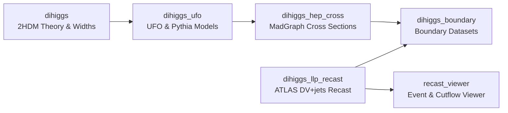

# ATLAS DiHiggs & LLP Recast Workspace

A modular research workspace investigating long-lived scalars ($H_2$) in the 2HDM Type-I framework. The project explores regions where the heavy neutral CP-even scalar $H_2$ decays into Standard Model pairs ($H_2 \to b\bar{b}$) with macroscopic lifetimes ($c\tau \sim \text{mm}$ to $\text{m}$) and reinterprets the ATLAS displaced-vertex plus jets (DV+jets) search for them.



## Modular Structure

The workspace coordinates six independent git submodules:

| Module | Purpose & Scope |
|---|---|
| [`dihiggs`](dihiggs/) | 2HDM point evaluators, decay widths, theory scans; theory convention authority |
| [`dihiggs_ufo`](dihiggs_ufo/) | UFO model definitions, Pythia decay configurations, and Monte Carlo integration baselines |
| [`dihiggs_hep_cross`](dihiggs_hep_cross/) | MadGraph drivers, cross-section calculation, campaign state, and results authority |
| [`dihiggs_llp_recast`](dihiggs_llp_recast/) | Frozen ATLAS displaced-vertex + jets recast reproduction and scalar adaptations |
| [`dihiggs_boundary`](dihiggs_boundary/) | Integration of theory points, HB/HS constraints, production cross sections, and LLP responses |
| [`recast_viewer`](recast_viewer/) | Source-neutral interactive event display and cutflow explorer |

## Quick Start

```sh
# Clone complete workspace with all modules
git clone --recursive <url>

# Or clone root and initialize a single module
git clone <url> && git submodule update --init <module>

# Verify workspace integrity (requires pytest, PyYAML from requirements.txt)
python3 scripts/check_workspace.py
```

## Physics Authority & Provenance

Scientific validity in this workspace is governed by explicit contracts:

- **Theory convention authority**: [`dihiggs/docs/PROJECT_PHYSICS_AUTHORITY.md`](dihiggs/docs/PROJECT_PHYSICS_AUTHORITY.md) and [`dihiggs/conventions/physics_conventions.yaml`](dihiggs/conventions/physics_conventions.yaml).
- **Numerical result authority**: [`dihiggs_hep_cross/docs/CURRENT_DATA_AUTHORITY.md`](dihiggs_hep_cross/docs/CURRENT_DATA_AUTHORITY.md) and [`dihiggs_hep_cross/state/CURRENT_CAMPAIGN.yaml`](dihiggs_hep_cross/state/CURRENT_CAMPAIGN.yaml).

**Rule**: Never infer physics authority from file timestamps or local presence. Only artifacts registered in the active campaign YAML are authoritative.

---
Full documentation, toolchain guides, and module specifications are available in the [documentation site](https://fbientrigo.github.io/atlas_dihiggs/) (source in [`site/`](site/)).
