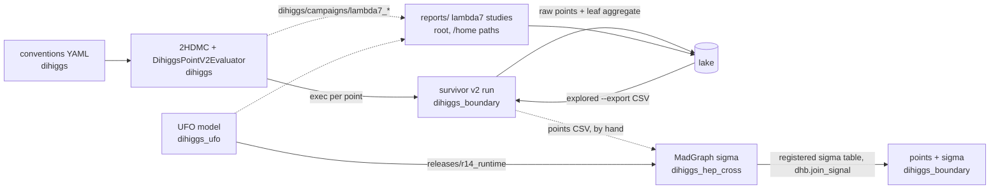

One page: who owns each responsibility, what each stage hands to the next, and which arrows still go by hand.
Rule: **code lives in its module, bulk data lives in the lake, git keeps code/config/small docs, the root keeps only the entry point.**
Every claim cites `file:line` (paths relative to the workspace root). Measured on 2026-10-27 (N-cut statuses updated 2026-10-28) at pins boundary `f2b81cd`, hep_cross `df95b4b`, ufo `9a7ba38` (C2/C7 re-measured at dihiggs `fdb708d`, ufo `fc56751`); `docs/audits/` is history only.

## The chain

Solid arrow = code reads the file. Dashed = by hand, hard-coded path, or missing.

| # | Arrow | Handoff (file, format) | Read by | How |
|---|---|---|---|---|
| 1 | conventions → evaluator | `dihiggs/conventions/physics_conventions.yaml` (sha256 `4f3a938e…`; the only copy since N1) | evaluator; provenance travels on each point (`dihiggs_hep_cross/scripts/run_physical_point_madgraph.py:183`) | code |
| 2 | evaluator → boundary run | executable `dihiggs/app/DihiggsPointV2Evaluator`, one `dihiggs.point.v2` CSV row per proposal | `dihiggs_boundary/configs/survivor_adaptive_12520_v1.yaml:3-4` (`dihiggs_root: ../../dihiggs`), resolved at `python/dhb/adaptive_m2_mesh.py:286` | code, sibling path |
| 3 | run → distillation | `<out>/<campaign_id>/raw_*_points.parquet`, `*_state.json` | `python/dhb/survivor_adaptive_aggregate.py:49` → `aggregate/rectangular_leaf_aggregate.parquet` | code |
| 4 | run → lake | campaign dir, blob `tar.zst` + tables `survivor_points`, `survivor_leaf_aggregate` | `lake/sources.tsv:5`, `lake sync` / `lake commit` | code |
| 5 | lake → next run | `lake explored --export FILE.csv` (`lake/lake.py:425`) | `survivor_adaptive_campaign.py:488` `--explored` | code |
| 6 | boundary → hep_cross | `--points-csv` / `--point` JSON (`run_physical_point_madgraph.py:513-514`) | no code produces it from a boundary run | **by hand** |
| 7 | UFO → hep_cross | `dihiggs_ufo/releases/r14_runtime/LLscalar_v3_UFO_runtime` (`dihiggs_hep_cross/scripts/env.sh` `DIHIGGS_PHYSICAL_POINT_UFO_DIR`, `generate_physical_point_proc_dir.sh` default) | MadGraph | code (N5): byte-identical to the old r14 copy (lake `20261014T025456Z-c67ca8`); closure σ identical |
| 8 | hep_cross → boundary | `sigma_production_fb`, `sigma_production_unc_fb` from the CSV named by `dihiggs_hep_cross/state/CURRENT_CAMPAIGN.yaml` `madgraph.authoritative_results` | `dihiggs_boundary/python/dhb/join_signal.py` (`point_id` key, VALID rows only) | code (N9, calibration step removed in task Q); registry is `null` today, so no σ is joined |
| 9 | dihiggs campaigns → reports | N8: the scripts now live in `dihiggs/studies/<report>/` and read `$DIHIGGS_ROOT` (default: workspace root above the script); they read `dihiggs/campaigns/lambda7_consolidation`, `reports/lambda7_tables_20261014/{BENCHMARKS.csv,mg5}` and write `reports/<name>/` (output only, in lake) | `dihiggs/studies/` | code (N8 done) |
| 10 | reports → lake | dirs as blobs | `lake/sources.tsv` row `reports` | code (new) |

## Ownership (one owner each)

| Responsibility | Owner | Path | Format |
|---|---|---|---|
| Physics conventions (m_h, v, convention id) | dihiggs | `conventions/physics_conventions.yaml` | YAML v3 |
| Evaluating one point (masses, widths, BR, cτ, theory gates) | dihiggs | `app/DihiggsPointV2Evaluator`, `2hdmc/` | C++ exe → CSV `dihiggs.point.v2` |
| Choosing points, leaf geometry, leaf verdicts | dihiggs_boundary | `python/dhb/survivor_adaptive_campaign.py`, `configs/` | campaign dir, Parquet/CSV + state JSON |
| HB/HS, σ join, boundary atlas (v0) | dihiggs_boundary | `python/dhb/{enrich,atlas,join_signal}.py` | CSV contracts (`python/dhb/contracts.py`) |
| UFO model | dihiggs_ufo | `LLscalar_v3_UFO_*` | UFO (Python) |
| Production cross section σ | dihiggs_hep_cross | `scripts/run_physical_point_madgraph.py`, `state/CURRENT_CAMPAIGN.yaml` | JSON/CSV + banner sha256 |
| Bulk data storage, coverage (`explored`) | lake | `lake/lake.py`, `lake/sources.tsv` | `tar.zst` blobs, Parquet tables |
| Entry point: README, check, site | root | `README.md`, `scripts/check_workspace.py`, `site/` | — |
| Pending work | GitHub issues | fbientrigo/atlas_dihiggs #1–#11 (#1–#10 were `tasks/fifo/003–012`; #3 and #11 closed 2026-10-29: recast dropped) | — |

## Root entries

| Entry | Producer → reader | Owner | State (2026-10-27) |
|---|---|---|---|
| 4 submodules | — | each module | pinned gitlinks (`dihiggs_llp_recast` and `recast_viewer` removed 2026-10-29; checkouts in `~/atlas_dihiggs_archive/recast_20261029/`) |
| `boundary hep_cross main_dihiggs ufos llm_wiki` | alias symlinks; read by code, not only manifests: `dihiggs_hep_cross/scripts/portable_paths.py:21` (workspace markers), `run_physical_point_madgraph.py:38` | root | kept |
| `lake/`, `site/`, `scripts/`, `docs/`, `.github/`, README/AGENTS/CLAUDE/requirements | — | root | tracked |
| `tasks/` | FIFO of pending work | GitHub issues | retired: issues #1–#10, removed from git |
| `experiments/` (461 MB) | dihiggs/hep_cross studies, Oct 10-12 | lake | all 15,869 files already in lake (4 commits, measured); local copy kept, ignored |
| `mission_runs/` | hep_cross audits Aug/Sep | lake | data in lake (`…-460a7f`, `…-6c5cfd`); local was only `.venv` + caches → deleted; 168 KB symlink skeleton left |
| `reports/` (≈650 MB) | λ7 tables → LLP families → cτ control (arrow 9) | dihiggs science, stored in lake | lake `20261028T024759Z-050cde` (8,997 files, 179 MB blob; every file sha256-checked, 0 differ); local kept, ignored. N6: the two `.zip` deleted (8.2 MB); N8: `scripts/` moved to `dihiggs/studies/` |
| `notas/` (4.5 MB) | Overleaf section 09 package | dihiggs science, lake | lake `20261028T024535Z-23952e`; local kept |
| `cernbox_catalog/` (28 MB) | catalog of CERNBox `~/cern_db` | lake | lake `20261028T024555Z-8417aa`; local kept |
| `_handoff/` (+ `HANDOFF_T2_T4.md`, moved in) | session handoffs | lake (history) | lake `20261028T024444Z-868a77`; local kept |
| ~~`results/bfb_negative_trilinear_audit/`~~ | BFB audit, `pytest` 6 passed | dihiggs | N7 done: now `dihiggs/tests/bfb_negative_trilinear_audit/` (`4cf7bea`); lake `20261028T024423Z-991e1b` keeps the old copy |
| ~~`env.sh`~~ | MG5_HOME + UFO dir for hep_cross | dihiggs_hep_cross | N7 done: now `dihiggs_hep_cross/scripts/env.sh` (`3a0860b`); `. dihiggs_hep_cross/scripts/env.sh` |
| `graphify-out/`, `.agy-staff/`, `.claude/`, `.venv/` | tool caches/state | local | kept, ignored |
| `build/`, `tests/` | empty after the move | junk | deleted |

## Combinations found

| # | Same responsibility in 2+ places (measured) | Verdict |
|---|---|---|
| C1 | Convention YAML in 5 repos, byte-identical (sha256 `4f3a938e…`) | **fixed (N1)**: dihiggs only |
| C2 | 2HDMC in 3 copies, **not** the same patch: THDM.cpp differs by 218 lines dihiggs↔boundary, 130 dihiggs↔hep_cross, 192 boundary↔hep_cross (dihiggs `fdb708d` now carries `set_param_gen_exact`, `calc_unitarity_spectrum`; boundary `70bbdf3` names them in its title but ports only the m12² cache) | **fixed (N2)**: one copy, `dihiggs/2hdmc` |
| C3 | Same files in git **and** lake, byte-identical: hep_cross 397 files/14.2 MB, ufo 1,397/46.4 MB, recast_viewer 204/629.6 MB, llp_recast 182/1.4 MB (repo-wide `keep` rows snapshot code repos) | **fixed for the future**: `lake sync` skips git-tracked files (`lake/lake.py` `cmd_sync`, test `sync_skips_tracked`); old blobs stay (add-only); git side **fixed (N3)** for hep_cross data and recast_viewer |
| C4 | Campaign outputs in 4 layouts: `dihiggs/campaigns/` (untracked), `dihiggs_boundary/data/runs/` + `dihiggs_boundary/campaigns/` (ignored), `dihiggs_hep_cross/campaigns/` (227 files tracked) | **fixed (N4)** for boundary (`data/runs` merged into `campaigns/`); hep_cross data untracked by N3, its study code/docs stay tracked |
| C5 | Root scratch: `results/`, `reports/`, `mission_runs/`, `experiments/`, `notas/` | **fixed**: all in lake under `forbidden_as_current`, one `sources.tsv` row each; nothing new goes at root |
| C6 | Work tracking in `tasks/`, `docs/audits/`, `HANDOFF_T2_T4.md` | **fixed**: issues #1–#10; audits = history; handoff in `_handoff/` → lake |
| C7 | Production UFO lives in `hep_cross/results/r14…` (absent locally), not in dihiggs_ufo; differs from `LLscalar_v3_UFO_original` in 4 files | **fixed (N5)**: `dihiggs_ufo/releases/r14_runtime` |
| C8 | `reports/*.zip` next to the same report dirs | **fixed (N6)**: zips deleted, dirs in lake |

## Next cuts (all done)

Done on 2026-10-28: N1, N3, N4, N6, N7, N8 by task L; N2, N5, N9 by task M. Commit ids are on the module branches (pushed fast-forward).

| # | Status | What was done | Commits | Removed from git |
|---|---|---|---|---|
| N1 | **done** | convention YAML + `.lock.yaml` + copy-only tests deleted in boundary, hep_cross, llp_recast, ufo; `hep_cross/src/llp_recast/constants.py` reads `dihiggs/conventions/…` (sibling or `$DIHIGGS_ROOT`, checksum + clear error when missing); `external_tools.lock.yaml` keeps only the sha pin; `check_workspace.py` keeps the one sha check | boundary `4d15a9e`, hep_cross `bb0ca13`, llp_recast `077b987`, ufo `82f579f` | 10 files, 1,276 lines. Tests: boundary 121 pass / 4 pre-existing fail / 1 skip (was 123/4/1; 2 copy-only tests deleted); hep_cross, llp_recast (1 skip), ufo (1 skip) all pass |
| N3 | **done** | hep_cross: 236 data files (csv/json/dat/txt/log/lha/png/pdf/…) under `campaigns/ results/ artifacts/` untracked, each HEAD blob sha256-checked in lake (314/314 data+code files incl. kept ones: 0 differ); `.gitignore` rows + README "Restoring data". recast_viewer: `public/data` + `validation/h2_geometry_telemetry` (98 files, 594 MB, 98/98 identical in lake `20261013T002548Z-190699`), `make restore-data` | hep_cross `4e47ebb`, recast_viewer `804a547` | 11.5 MB + 594 MB in the working tree (history keeps them) |
| N4 | **done** | boundary: `data/runs/` merged into `campaigns/` (3 configs repointed, `.gitkeep` removed, `.gitignore`: `campaigns/<id>/campaign.yaml` tracked, rest ignored); survivor v2 `campaign.yaml` restored from lake `…-8292bb` and tracked; `sources.tsv` rows 1-4 → 1 row (`dihiggs_boundary/campaigns/*`). hep_cross: campaigns already `campaigns/<id>/`; no `campaign.yaml` exists there (state is `state/CURRENT_CAMPAIGN.yaml`), study code/docs stay tracked | boundary `70229f3` + root | 3 `sources.tsv` rows; boundary tests 124 pass / 1 fail (golden) / 1 skip, the 3 survivor-v2 tests that failed for the missing `campaign.yaml` now pass |
| N6 | **done** | `reports/ctau_control_20261020.zip`, `reports/llp_families_20261019.zip` deleted after all 8,997 files of `reports/` matched lake `20261028T024759Z-050cde` by sha256 (the zips are in that commit too) | — (untracked) | 8.2 MB local |
| N7 | **done** | `env.sh` → `dihiggs_hep_cross/scripts/env.sh` (`DIHIGGS_ROOT` = two levels up); BFB audit + test → `dihiggs/tests/bfb_negative_trilinear_audit/` (6 passed; `.gitignore` exception for its CSV) | hep_cross `3a0860b`, dihiggs `4cf7bea` | 2 root entries |
| N8 | **done** | 19 scripts of `reports/*/scripts` → `dihiggs/studies/<report>/`, no `/home/fabian`; `dihiggs/studies/ctau_control_20261020/finalize_ctau.py` rerun in a copy: `selected_points.csv`, `raw/ranges.json`, `validated_benchmarks.csv`, `table_ctau_mixed250.tex` identical to the frozen files (`cmp`) | dihiggs `4834b05` | 6→0 hard-coded roots; the other scripts compile, their backends were not rerun |
| N2 | **done** | `dihiggs/2hdmc` is the one 2HDMC: it already carried everything boundary and hep_cross had (both copies are subsets apart from comments); hep_cross's `GeneralProbe.cpp` moved in. Boundary builds `$DHB_2HDMC_ROOT` (default `../dihiggs/2hdmc`); its CI checks out dihiggs at a pinned sha. **Gates:** boundary `evaluate_point` byte-identical old vs new on the golden input and on 4,000 random points (tanβ 1…1e8, λ6 1e-14…1); the golden oracle test fails exactly as before N2 (max rel 7.8e-10, `p5.width_gg_H2`, present since boundary `70bbdf3`); hep_cross `logs/run_all_probes.py` reproduces its 4 tracked CSVs byte for byte; dihiggs 2hdmc tests 55 pass / 2 skip; boundary 127 pass / 1 fail (that golden test) / 1 skip | dihiggs `a3b4907`, boundary `7162f31`, hep_cross `1b40d56` (deletions, swept into the N5 commit) + `e40d36a` | boundary `lib/2HDMC-1.8.0` (41 files, lake `20261028T200807Z-d116d2`, 41/41 sha256) and hep_cross `2hdmc_build` (83 files, lake `20261013T001001Z-a347d8`, 83/83 sha256) |
| N5 | **done** | 14 `.py` of the r14 runtime UFO committed as `dihiggs_ufo/releases/r14_runtime/LLscalar_v3_UFO_runtime` (14/14 sha256 = lake `20261014T025456Z-c67ca8`; differs from `_original` in `couplings.py`, `parameters.py`, `write_param_card.py`); `env.sh` and `generate_physical_point_proc_dir.sh` default to it. **Gate:** closure benchmark (m_H2 150, g 63.59, seeds 101/107, 10k events) σ = 0.23025 ± 0.00163 fb with old and new UFO, identical; the frozen 0.230291 fb came from a different setup (1000 events, hep_cross `1da2f70`) and is 0.02% away (test band 3%) | ufo `c41f452`, hep_cross `1b40d56` | 1 hidden dependency |
| N9 | **done** | `python -m dhb.join_signal --points --registry --calibration --output`: σ only from the registry's `madgraph.authoritative_results` (no `--sigma` flag), VALID rows, duplicate `point_id` fails, then `dhb.llp_signal`. Calibration YAML created from llp_recast artifacts only; missing values `null` + issue #11 (also records the r7/r8 A×ε disagreement at cτ = 4.326 mm). Issue #3 (full end-to-end benchmark) stays open: N9 is its join step, not the benchmark | boundary `1fab1c1`, llp_recast `01fd17c` | by-hand arrows 8, 9 (arrow 6, points → MadGraph, is still by hand) |

Task N (2026-10-28): boundary golden `evaluate_point_v1` regenerated for the accepted 70bbdf3 2HDMC shift (max rel 7.8e-10, `p5.width_gg_H2`; 92 float cells, no other change; boundary `23126c8`); boundary CI green again (matplotlib installed, golden built against dihiggs `a3b4907`, the 4 evaluator-dependent `_load` tests skip without the sibling build; `3513167`).

Task Q (2026-10-29): recast removed. Root: submodules `dihiggs_llp_recast`, `recast_viewer`, the `llp_recast` alias, their site pages, API rows and lake `sources.tsv` rows (lake data stays). hep_cross `565fa2b`, `4f35ad5`: recast package modules, r9/r10/mass-jet/scale scripts, DV+jets HEPData, their tests and docs. boundary `e09cc19`, `c2f1939`: `llp_signal`, `llp_calibration`, `point_fields`, `atlas_v1` and `join_signal`'s calibration step. Rows N1/N5/N9 and C3 above are history and still name the removed pieces. Kept on purpose: `dihiggs/conventions/physics_conventions.yaml` (pinned bytes) still lists `dihiggs_llp_recast` as an owner.
