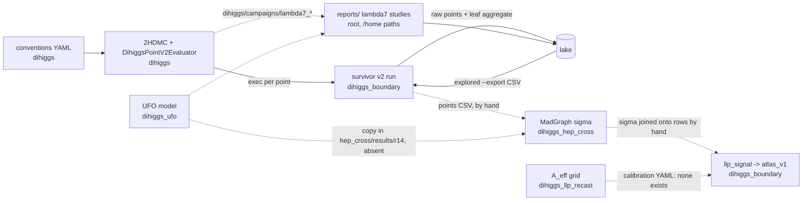

One page: who owns each responsibility, what each stage hands to the next, and which arrows still go by hand.
Rule: **code lives in its module, bulk data lives in the lake, git keeps code/config/small docs, the root keeps only the entry point.**
Every claim cites `file:line` (paths relative to the workspace root). Measured on 2026-10-27; `docs/audits/` is history only.

## The chain

Solid arrow = code reads the file. Dashed = by hand, hard-coded path, or missing.

| # | Arrow | Handoff (file, format) | Read by | How |
|---|---|---|---|---|
| 1 | conventions → evaluator | `dihiggs/conventions/physics_conventions.yaml` (sha256 `4f3a938e…`) | evaluator; provenance travels on each point (`dihiggs_hep_cross/scripts/run_physical_point_madgraph.py:183`) | code |
| 2 | evaluator → boundary run | executable `dihiggs/app/DihiggsPointV2Evaluator`, one `dihiggs.point.v2` CSV row per proposal | `dihiggs_boundary/configs/survivor_adaptive_12520_v1.yaml:3-4` (`dihiggs_root: ../../dihiggs`), resolved at `python/dhb/adaptive_m2_mesh.py:286` | code, sibling path |
| 3 | run → distillation | `<out>/<campaign_id>/raw_*_points.parquet`, `*_state.json` | `python/dhb/survivor_adaptive_aggregate.py:49` → `aggregate/rectangular_leaf_aggregate.parquet` | code |
| 4 | run → lake | campaign dir, blob `tar.zst` + tables `survivor_points`, `survivor_leaf_aggregate` | `lake/sources.tsv:5`, `lake sync` / `lake commit` | code |
| 5 | lake → next run | `lake explored --export FILE.csv` (`lake/lake.py:425`) | `survivor_adaptive_campaign.py:488` `--explored` | code |
| 6 | boundary → hep_cross | `--points-csv` / `--point` JSON (`run_physical_point_madgraph.py:513-514`) | no code produces it from a boundary run | **by hand** |
| 7 | UFO → hep_cross | proc dir from `hep_cross/results/r14_direct_g_production/ufo/…/LLscalar_v3_UFO_runtime` (`generate_physical_point_proc_dir.sh:14-21`, `env.sh:11`) | MadGraph | **ad hoc**: path through the `hep_cross` alias; dir absent locally; the only copy is lake commit `20261014T025456Z-c67ca8`, and 4/15 files (`parameters.py`, `couplings.py`, …) differ from `dihiggs_ufo/LLscalar_v3_UFO_external_GHphiphi` |
| 8 | hep_cross → boundary | `sigma_production_fb`, `sigma_production_unc_fb` columns on each row | `dihiggs_boundary/python/dhb/llp_signal.py:76-92` ("upstream production stage must join these") | **by hand**, no joiner |
| 9 | llp_recast → boundary | `--calibration` "versioned Trackless response YAML" (`llp_signal.py:225`) | `python/dhb/llp_calibration.py:34` | **missing**: no calibration file is tracked in any repo; `dihiggs_llp_recast/scripts/make_aeff_grid_products.py:83` writes grid CSV/JSON |
| 10 | dihiggs campaigns → reports | `ROOT = Path("/home/fabian/atlas_dihiggs")` (`reports/llp_families_20261019/scripts/core.py:19`; also `production.py:10`, `finalize.py:18`, and 3 scripts in `reports/lambda7_tables_20261014/scripts/`); reads `dihiggs/campaigns/lambda7_consolidation`, `reports/lambda7_tables_20261014/{BENCHMARKS.csv,mg5}`; `ctau_control` imports `core.py` | report scripts | **hard-coded /home paths** |
| 11 | reports → lake | dirs as blobs | `lake/sources.tsv` row `reports` | code (new) |

## Ownership (one owner each)

| Responsibility | Owner | Path | Format |
|---|---|---|---|
| Physics conventions (m_h, v, convention id) | dihiggs | `conventions/physics_conventions.yaml` | YAML v3 |
| Evaluating one point (masses, widths, BR, cτ, theory gates) | dihiggs | `app/DihiggsPointV2Evaluator`, `2hdmc/` | C++ exe → CSV `dihiggs.point.v2` |
| Choosing points, leaf geometry, leaf verdicts | dihiggs_boundary | `python/dhb/survivor_adaptive_campaign.py`, `configs/` | campaign dir, Parquet/CSV + state JSON |
| HB/HS, σ×BR×A_eff, boundary atlas | dihiggs_boundary | `python/dhb/{enrich,llp_signal,atlas_v1}.py` | CSV contracts (`python/dhb/contracts.py`) |
| UFO model | dihiggs_ufo | `LLscalar_v3_UFO_*` | UFO (Python) |
| Production cross section σ | dihiggs_hep_cross | `scripts/run_physical_point_madgraph.py`, `state/CURRENT_CAMPAIGN.yaml` | JSON/CSV + banner sha256 |
| DV+jets response A_eff(cτ) | dihiggs_llp_recast | `scripts/make_aeff_grid_products.py` → `results/` | CSV/JSON grid |
| Event display | recast_viewer | `public/data/` | JSON |
| Bulk data storage, coverage (`explored`) | lake | `lake/lake.py`, `lake/sources.tsv` | `tar.zst` blobs, Parquet tables |
| Entry point: README, check, site | root | `README.md`, `scripts/check_workspace.py`, `site/` | — |
| Pending work | GitHub issues | fbientrigo/atlas_dihiggs #1–#10 (were `tasks/fifo/003–012`) | — |

## Root entries

| Entry | Producer → reader | Owner | State (2026-10-27) |
|---|---|---|---|
| 6 submodules | — | each module | pinned gitlinks |
| `boundary hep_cross llp_recast main_dihiggs ufos llm_wiki` | alias symlinks; read by code, not only manifests: `dihiggs_hep_cross/scripts/portable_paths.py:21` (workspace markers), `run_physical_point_madgraph.py:38` | root | kept |
| `lake/`, `site/`, `scripts/`, `docs/`, `.github/`, README/AGENTS/CLAUDE/requirements | — | root | tracked |
| `tasks/` | FIFO of pending work | GitHub issues | retired: issues #1–#10, removed from git |
| `experiments/` (461 MB) | dihiggs/hep_cross studies, Oct 10-12 | lake | all 15,869 files already in lake (4 commits, measured); local copy kept, ignored |
| `mission_runs/` | hep_cross audits Aug/Sep | lake | data in lake (`…-460a7f`, `…-6c5cfd`); local was only `.venv` + caches → deleted; 168 KB symlink skeleton left |
| `reports/` (657 MB) | λ7 tables → LLP families → cτ control (arrow 10) | dihiggs science, stored in lake | committed to lake; local kept, ignored |
| `notas/` (4.5 MB) | Overleaf section 09 package | dihiggs science, lake | committed to lake; local kept |
| `cernbox_catalog/` (28 MB) | catalog of CERNBox `~/cern_db` | lake | committed to lake; local kept |
| `_handoff/` (+ `HANDOFF_T2_T4.md`, moved in) | session handoffs | lake (history) | committed to lake; local kept |
| `results/bfb_negative_trilinear_audit/` (+ its test, moved in from `tests/`) | BFB audit, `pytest` 6 passed | dihiggs | committed to lake; see Next cuts |
| `env.sh` | MG5_HOME + UFO dir for hep_cross | dihiggs_hep_cross | left in place; see Next cuts |
| `graphify-out/`, `.agy-staff/`, `.claude/`, `.venv/` | tool caches/state | local | kept, ignored |
| `build/`, `tests/` | empty after the move | junk | deleted |

## Combinations found

| # | Same responsibility in 2+ places (measured) | Verdict |
|---|---|---|
| C1 | Convention YAML in 5 repos, byte-identical (sha256 `4f3a938e…`); the 4 caches are read only by their own tests and `external_tools.lock.yaml` | proposal N1 (touches hep_cross/ufo) |
| C2 | 2HDMC in 3 copies, **not** the same patch: THDM.cpp differs by 171 lines dihiggs↔boundary, 51 dihiggs↔hep_cross, 192 boundary↔hep_cross; dihiggs has an uncommitted 5-file patch (+234/−8, `set_param_gen_exact`, `calc_unitarity_spectrum`) that boundary `70bbdf3` names in its title but only partly ports (m12² cache) | proposal N2 |
| C3 | Same files in git **and** lake, byte-identical: hep_cross 397 files/14.2 MB, ufo 1,397/46.4 MB, recast_viewer 204/629.6 MB, llp_recast 182/1.4 MB (repo-wide `keep` rows snapshot code repos) | **fixed for the future**: `lake sync` skips git-tracked files (`lake/lake.py` `cmd_sync`, test `sync_skips_tracked`); old blobs stay (add-only); N3 for git side |
| C4 | Campaign outputs in 4 layouts: `dihiggs/campaigns/` (untracked), `dihiggs_boundary/data/runs/` + `dihiggs_boundary/campaigns/` (ignored), `dihiggs_hep_cross/campaigns/` (227 files tracked) | proposal N4 |
| C5 | Root scratch: `results/`, `reports/`, `mission_runs/`, `experiments/`, `notas/` | **fixed**: all in lake under `forbidden_as_current`, one `sources.tsv` row each; nothing new goes at root |
| C6 | Work tracking in `tasks/`, `docs/audits/`, `HANDOFF_T2_T4.md` | **fixed**: issues #1–#10; audits = history; handoff in `_handoff/` → lake |
| C7 | Production UFO lives in `hep_cross/results/r14…` (absent locally), not in dihiggs_ufo; differs from `LLscalar_v3_UFO_external_GHphiphi` in 4 files | proposal N5 |
| C8 | `reports/*.zip` next to the same report dirs | kept (user data), proposal N6 |

## Next cuts (proposals; not done because task J owns dihiggs, hep_cross and ufo right now)

| # | Delete | Replaced by | Risk | Saves |
|---|---|---|---|---|
| N1 | `conventions/physics_conventions{,.lock}.yaml` + their tests in boundary, hep_cross, llp_recast, ufo | the dihiggs file via its gitlink; `scripts/check_workspace.py` keeps the one sha check; points already carry `physics_conventions_{schema,commit,sha256}` | a module cloned alone has no YAML (only tests read it today) | 8 files, 1,276 lines |
| N2 | `dihiggs_boundary/lib/2HDMC-1.8.0` (41 files, 0.5 MB) and `dihiggs_hep_cross/campaigns/physical_vs_effective_coupling_v1/2hdmc_build` (83 files, 2.2 MB, already in lake `…-a347d8`) | commit dihiggs's working patch first, then boundary builds `$DHB_2HDMC_ROOT=../dihiggs/2hdmc` (`dihiggs_boundary/scripts/setup_env.sh:8` already has the knob) | **physics numbers can move**: the copies differ, so boundary golden tests (`scripts/generate_golden_evaluate_point.py`) must pass bit-for-bit or the diff is reviewed | 124 files, 2.7 MB |
| N3 | hep_cross tracked `campaigns/`, `results/`, `artifacts/` data (≈397 files, 14 MB, already in lake) and recast_viewer `public/data` + `validation/h2_geometry_telemetry` (≈594 MB in git) | lake commits + `lake restore` in the module README | the viewer's Pages build needs a restore step | ≈608 MB of git |
| N4 | the four layouts | one rule: `<module>/campaigns/<id>/campaign.yaml` tracked, everything else ignored and in lake; boundary merges `data/runs/` into `campaigns/` (sources.tsv rows 1-4 → one) | path changes for resumable runs (`*_state.json` kept by `-*_state.json`) | 3 sources.tsv rows |
| N5 | `hep_cross/results/r14…/ufo` as the production default | `DIHIGGS_PHYSICAL_POINT_UFO_DIR` default → a dihiggs_ufo release that carries the 4 differing files (commit them in dihiggs_ufo first) | σ changes if the wrong UFO is picked; requires the 0.230291 fb closure check | 1 hidden dependency |
| N6 | `reports/ctau_control_20261020.zip`, `reports/llp_families_20261019.zip` (8.2 MB) | the dirs (in lake) | needs user OK (data) | 8.2 MB |
| N7 | root `env.sh`, `results/bfb_negative_trilinear_audit/` | `dihiggs_hep_cross/scripts/env.sh`; the BFB audit + test into `dihiggs/tests/` | none (both untracked, both in lake) | 2 root entries |
| N8 | hard-coded `/home/fabian/atlas_dihiggs` in `reports/*/scripts` | the report code moves to dihiggs as a study script reading `$DIHIGGS_ROOT`; reports stay output-only in lake | reruns must reproduce the frozen CSVs | 6 scripts |
| N9 | by-hand arrows 6, 8, 9 | one `dhb` join step (`point_id` key) from a hep_cross σ table and a tracked llp_recast calibration YAML | authority: σ must come from `CURRENT_CAMPAIGN.yaml`-registered runs only | closes task #3 (issue) |
