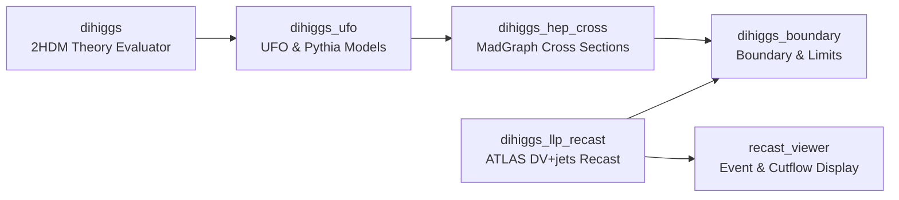

# ATLAS DiHiggs & LLP Recast

Welcome to the **ATLAS DiHiggs & Long-Lived Particle (LLP) Recast** workspace documentation.

This workspace coordinates an end-to-end phenomenological research pipeline investigating long-lived neutral scalar bosons ($H_2$) within the **Two-Higgs-Doublet Model (2HDM) Type-I** framework. By focusing on parameter domains where $H_2$ exhibits macroscopic decay lengths ($c\tau \sim \text{mm}$ to $\text{m}$) and decays primarily into bottom quark pairs ($H_2 \to b\bar{b}$), the project reinterprets (recasts) ATLAS displaced-vertex plus jets (DV+jets) search results to extract novel experimental exclusion bounds and project high-luminosity discovery potentials.

---

## Scientific Workflow Pipeline

The simulation, recast, and interpretation pipeline spans six distinct stages, passing from analytical theory evaluation to detector response and interactive visualization:

1. **Theory Evaluation (`dihiggs`)**: Evaluates 2HDM parameter points, checks theoretical consistency (positivity, unitarity, perturbativity), and calculates decay widths, branching ratios, and proper decay lengths ($c\tau$).
2. **Model Integration (`dihiggs_ufo`)**: Provides Universal FeynRules Output (UFO) models and Pythia 8 decay configurations for Monte Carlo event generation.
3. **Event Generation & Cross Sections (`dihiggs_hep_cross`)**: MadGraph 5 drivers generate hard-scattering matrix elements and compute production cross sections ($\sigma_{\text{production}}$) for physical parameter points.
4. **Detector Recast (`dihiggs_llp_recast`)**: Reproduces the frozen ATLAS DV+jets search baseline and evaluates reconstruction acceptance times efficiency response curves ($A_{\text{eff}}(c\tau)$) for long-lived $H_2 \to b\bar{b}$.
5. **Boundary Integration (`dihiggs_boundary`)**: Merges theory points, experimental constraints (HiggsBounds / HiggsSignals), production cross sections, and recast response to evaluate signal yields ($\sigma_{4b}$, $\sigma_{\text{visible}}$, $N_{\text{expected}}$) and exclusion boundaries.
6. **Visualization (`recast_viewer`)**: Interactive diagnostic viewer rendering reconstructed events, track geometry, and cutflows without presenting displays as raw detector data.

---

## Workspace Architecture

The root repository coordinates the project through Git submodules. Each core component is maintained as an independent repository with its own versioning, issue tracking, and test suites:

| Module | Primary Scientific Responsibility |
|---|---|
| [**`dihiggs`**](modules.md#dihiggs) | Canonical 2HDM Type-I point evaluators, decay widths, and scans. Holds theory convention authority. |
| [**`dihiggs_ufo`**](modules.md#dihiggs_ufo) | UFO model files (Pack A) and Pythia decay engines (Pack AA). |
| [**`dihiggs_hep_cross`**](modules.md#dihiggs_hep_cross) | MadGraph production drivers, cross-section ingestion, campaign state, and numerical results authority. |
| [**`dihiggs_llp_recast`**](modules.md#dihiggs_llp_recast) | Public ATLAS DV+jets recast baseline reproduction and scalar adaptations. |
| [**`dihiggs_boundary`**](modules.md#dihiggs_boundary) | Integration of theory observables, HB/HS constraints, MadGraph cross sections, and recast efficiencies into boundary datasets. |
| [**`recast_viewer`**](modules.md#recast_viewer) | Source-neutral interactive event display and cutflow explorer. |

---

## Next Steps

- **[Getting Started](getting-started.md)**: Workspace setup, cloning instructions, environment requirements, and heavy physics toolchain prerequisites.
- **[Modules Overview](modules.md)**: Detailed scientific roles and documentation pointers for each component submodule.
- **[Physics Authority & Provenance](authority.md)**: Strict contracts governing theory conventions and numerical data authority.
- **[Data Lake](lake.md)**: Storage layout and DuckDB query interface for project-wide datasets on Google Drive.
