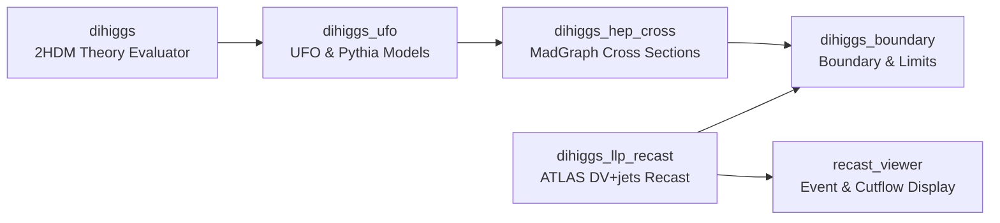

  

    // PROTOCOL: ATLAS_DIHIGGS_WORKSPACE
    SYSTEM: NOMINAL
  

  

    Welcome to the <strong>ATLAS DiHiggs &amp; Long-Lived Particle (LLP) Recast</strong> workspace documentation and API observatory.
  

  

    This multi-repository environment coordinates an end-to-end phenomenological research pipeline investigating long-lived neutral scalar bosons (<em>H</em>2) within the <strong>Two-Higgs-Doublet Model (2HDM) Type-I</strong> framework. By focusing on parameter regimes where <em>H</em>2 exhibits macroscopic decay lengths (<em>c</em>&tau; ~ mm to m) and decays dominantly to bottom quarks (<em>H</em>2 &rarr; <em>b</em>b̄), the project reinterprets (recasts) ATLAS displaced-vertex plus jets (DV+jets) search results to extract novel exclusion bounds and evaluate high-luminosity discovery potentials.
  

## Scientific Architecture

The workspace coordinates six Git submodules, passing from Lagrangian theory evaluation to detector response simulation and interactive 3D visualization:

## Modular Components

  

    

      dihiggs // THEORY
      AUTHORITY
    

    

      Canonical 2HDM Type-I parameter evaluation, decay widths, branching ratios, lifetime calculation, and parameter space scans. Single source of truth for theory conventions.
    

    <a href="/modules/dihiggs/">View Module Specification &rarr;</a>
  

  

    

      dihiggs_ufo // UFO
      BASELINE
    

    

      Universal FeynRules Output models (Pack A) and Pythia 8 decay engines (Pack AA) for long-lived scalar event generation.
    

    <a href="/modules/dihiggs-ufo/">View Module Specification &rarr;</a>
  

  

    

      dihiggs_hep_cross // MADGRAPH
      RESULTS
    

    

      Matrix-element event generation, production cross-section calculations (&sigma;production), run banner verification, and numerical result authority.
    

    <a href="/modules/dihiggs-hep-cross/">View Module Specification &rarr;</a>
  

  

    

      dihiggs_llp_recast // RECAST
      FROZEN
    

    

      Reproduction of the frozen ATLAS displaced-vertex plus jets search baseline, trackless jet selections, and <em>A</em>eff(<em>c</em>&tau;) response curves.
    

    <a href="/modules/dihiggs-llp-recast/">View Module Specification &rarr;</a>
  

  

    

      dihiggs_boundary // BOUNDARY
      LIMITS
    

    

      Enrichment of theory observables with HiggsBounds/HiggsSignals limits, direct production cross sections, and recast efficiencies into analysis-ready boundary atlases.
    

    <a href="/modules/dihiggs-boundary/">View Module Specification &rarr;</a>
  

  

    

      recast_viewer // DISPLAY
      3D VIEWER
    

    

      Interactive 3D Three.js event display, track geometry inspection, and cutflow counterfactual toggle interface.
    

    <a href="/modules/recast-viewer/">View Module Specification &rarr;</a>
  

---

## Authority & Governance

Scientific integrity across six independent repositories requires strict governance:

- **Zero Timestamp Authority**: Never infer validity from file timestamps or presence on disk. Only artifacts registered in `CURRENT_CAMPAIGN.yaml` are authoritative.
- **Convention Separation**: Theory definitions are strictly separated from numerical cross sections and event samples.
- **Code Reference**: Continuous static code audits inspect Doxygen XML and Griffe AST to ensure full traceability down to exact GitHub lines.

Check the [Physics Authority & Provenance](/authority/) contract and the [API Reference](/api/) for complete details.
