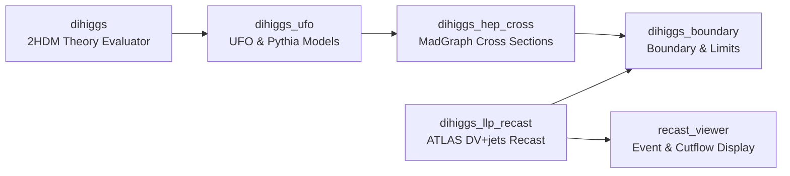

  

    // PIPELINE_EXECUTION: END-TO-END PHENOMENOLOGICAL STAGES
    STAGE: COMPLETE
  

  

    The simulation, recast, and interpretation pipeline spans six distinct stages, passing from analytical theory evaluation to detector response and interactive visualization. Each stage defines an explicit input/output contract; never substitute an output from an unrelated campaign or parameter point.
  

---

## 1. Theory Point Evaluation (`dihiggs`)

Run 2HDMC-based point evaluation to verify theoretical viability and calculate decay parameters:

- **Reference Contract**: `dihiggs/docs/contracts/canonical_evaluators_v2.md`
- **Active Authority**: $m_h = 125.20\text{ GeV}$ (`mh_125p20_active_2026`)
- **Key Executables**:
  - `Lambda1EvaluatorV2`: Target $\lambda_1$ point evaluation under schema `dihiggs.lambda1.v2`.
  - `DihiggsPointV2Evaluator`: Rectangular grid evaluation in $(m_H, M_2)$ under schema `dihiggs.point.v2`.
- **Outputs**:
  Theoretical consistency checks (tree-level unitarity, perturbativity, stability/positivity), physical scalar masses ($m_{H_2}, m_A, m_{H^\pm}$), total decay widths ($\Gamma_{\text{total}}$), branching ratios ($\text{BR}(H_2 \to b\bar{b})$), and proper decay length:
  $$c\tau = \frac{\hbar c}{\Gamma_{\text{total}}}$$

---

## 2. UFO Model Integration & Particle Decays (`dihiggs_ufo`)

Translate theoretical scalar interactions into Monte Carlo simulation drivers:

- **Frozen Production Baseline**: Pack A (`pi_ufo_baseline_v1_frozen_hotfix1.zip`, SHA-256 `58f1e976...`)
- **Decay Engine**: Pack AA Pythia 8 decay configurations for long-lived scalar bosons
- **Integration Stability**: Multi-seed integration studies (30 independent seeds, Birge ratio 0.99)
- **Key Documents**: `dihiggs_ufo/CURRENT_STATE.md` and `dihiggs_ufo/ARTIFACT_REGISTRY.json`

---

## 3. MadGraph Cross Sections (`dihiggs_hep_cross`)

Execute hard-scattering matrix-element integration for certified physical points:

- **Coupling Prescription**: Canonical `physical_2HDM` coupling prescription with trilinear coupling:
  $$GH\phi\phi = -g_{\text{physical, } h\phi\phi}$$
- **Key Drivers**: `scripts/run_physical_point_madgraph.py`
- **Provenance Verification**: Every cross section must have a verified run banner checked with `scripts/madgraph_banner_verification.py`.
- **Outputs**: Production cross sections ($\sigma_{\text{production}}$) at $\sqrt{s} = 13\text{ TeV}$ with cryptographic provenance metadata.

---

## 4. Detector Recast Baseline (`dihiggs_llp_recast`)

Evaluate displaced-vertex plus jets detection efficiencies using the frozen public ATLAS search:

- **Baseline Commit**: `d4047c744062094c9f88e507bb1ccf69e9fe88d6`
- **Benchmark**: $m_{H_2} = 150\text{ GeV}$, $c\tau = 4.32622\text{ mm}$, $H_2 \to b\bar{b}$, `Trackless_Aeff = 0.01573386`
- **Analysis Mode**: Canonical `original/published Trackless` (R8/R10 response). The separate `modified` analysis mode is a distinct selection and not interchangeable.
- **Outputs**: Reconstructed acceptance times efficiency response curves:
  $$A_{\text{eff}}(c\tau)$$

---

## 5. Signal Yield & Boundary Integration (`dihiggs_boundary`)

Merge physical stages into analysis-ready boundary datasets and compute experimental yields:

- **Joins**: Theory observables ($m_{H_2}, g_{hH_2H_2}, c\tau, \text{BR}_{bb}$), experimental constraints (HiggsBounds / HiggsSignals), production cross section $\sigma_{\text{production}}$, and recast response $A_{\text{eff}}$ by `point_id`.
- **Signal Yield Observables**:
  $$\sigma_{4b} = \sigma_{\text{production}} \times \text{BR}(H_2 \to b\bar{b})^2$$
  $$\sigma_{\text{visible}} = \sigma_{4b} \times A_{\text{eff}}$$
  $$N_{\text{expected}} = \mathcal{L} \times \sigma_{\text{visible}}$$
- **Validation**: Strict domain validation rejects unphysical extrapolation beyond calibrated domains.

---

## 6. Interactive Visualization & Cutflow Inspection (`recast_viewer`)

Source-neutral interactive event display and cutflow explorer:

- **Engine**: Three.js 3D event rendering, $R\text{–}z$ and $x\text{–}y$ track projections, transverse impact parameter ($d_0$) tracking.
- **Diagnostic Role**: Cutflow analyzer and boolean counterfactual toggle interface without substituting for raw detector data.
- **Adapters**: `OriginalRecastAdapter` and `LocalInstrumentedReferenceAdapter`.
